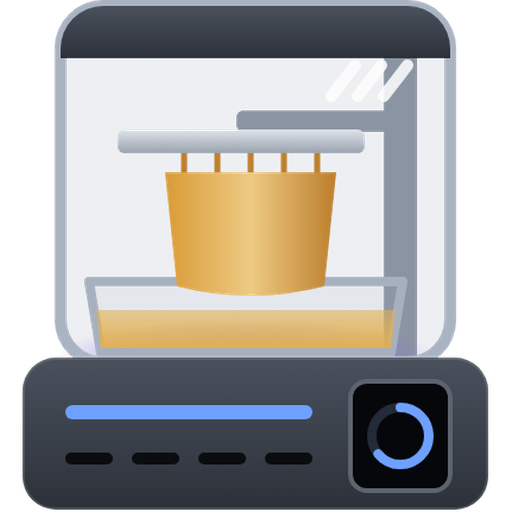

# SDCP 3D Printer for Home Assistant

Local integration and a Lovelace card for 3D printers that speak **SDCP**
(Smart Device Control Protocol) — Chitu-based boards such as the ELEGOO Saturn 4
Ultra 16K, Saturn 3/4 Ultra, Mars 4/5 Ultra, Jupiter and the FDM Centauri Carbon.
No cloud: Home Assistant talks to the printer over its own WebSocket
(`ws://<printer>:3030/websocket`) and finds printers with the SDCP UDP broadcast
(`M99999` → port 3000).

The Lovelace card lives in its own repository:
**[pollstar/sdcp-printer-card](https://github.com/pollstar/sdcp-printer-card)**.

<p>
  
</p>

## Supported printers

The integration speaks plain SDCP v3 and works with any printer that does; what differs
between machines is described by a **printer model** (`custom_components/sdcp/printers/`).

| Model | Printers | Card drawing | Notes |
|---|---|---|---|
| `elegoo-saturn-4-ultra` | ELEGOO Saturn 4 Ultra, Saturn 4 Ultra 16K | `saturn-4-ultra` | verified on hardware |
| `elegoo-centauri-carbon` | ELEGOO Centauri Carbon | `generic-fdm` | from community data, not verified yet |
| `generic-resin` | any other resin (MSLA) SDCP printer | `generic-resin` | fallback |
| `generic-fdm` | any other FDM SDCP printer | `generic-fdm` | fallback |

The *machine state* sensor reports the match in its attributes: `printer_model`,
`printer_profile` (the drawing the card loads) and `printer_kind`.

**Adding a printer** takes one capture (`scripts/capture_fixture.py`) and usually a few lines
in `printers/` — see [CONTRIBUTING.md](CONTRIBUTING.md). Captures of printers that are not
listed yet are welcome even without code.

## Entities

| Platform | Entities |
|---|---|
| sensor | machine state, print stage, progress, current / total layers, elapsed, remaining, finish time, file (job details in attributes: layer height, Z height, resin volume, exposure, thumbnail…), print error; resin: UV-LED, vat and vat target temperature, release-film cycles and wear, LCD hours; FDM: nozzle / bed / chamber temperatures and targets, fans, speed, Z offset; free storage, video streams |
| binary_sensor | connection, printing, vat heating, USB drive, one *problem* sensor per self-test check |
| button | pause, resume, stop, refresh |
| switch | time-lapse |
| image | preview of the current model |
| camera | printer camera (RTSP, **disabled by default**, see below) |

Sensors that the printer does not report are not created.

### Services

- `sdcp.start_print` — `device_id`, `filename` (path prefix optional), `start_layer`.
- `sdcp.delete_files` — `device_id`, `files` (full paths, e.g. `/local/old.ctb`).

### Events

`sdcp_event` with `type` = `print_started`, `print_paused`, `print_resumed`,
`print_finished`, `print_stopped`, `print_error`, `notice` or `error`, plus
`device_id`, `filename`, `task_id`, `layer`, `total_layers`.

```yaml
triggers:
  - trigger: event
    event_type: sdcp_event
    event_data: { type: print_finished }
actions:
  - action: notify.mobile_app_phone
    data: { message: "Print {{ trigger.event.data.filename }} is done" }
```

## Install

1. HACS → ⋮ → Custom repositories → this repository, category *Integration* → install,
   or copy `custom_components/sdcp` to `config/custom_components/`.
2. Restart Home Assistant.
3. Settings → Devices & services → Add integration → **SDCP 3D Printer**. Printers on the
   network are listed; or type the IP address (`host` or `host:port`).
4. Install the card: HACS → ⋮ → Custom repositories →
   `https://github.com/pollstar/sdcp-printer-card`, category *Dashboard* → install, then
   reload the browser.

Options: status interval while printing (default 3 s) and when idle (15 s).

Translations: English, French, German, Spanish, Ukrainian and Russian (config flow, entities,
services).
*Reconfigure* changes the printer's address.

## Icons

The integration ships its brand images in `custom_components/sdcp/brand/` (icon and logo,
light and dark, `@2x`); Home Assistant 2026.3 and newer shows them without the
`home-assistant/brands` repository. The sources are `docs/icon.svg` / `docs/dark_icon.svg`.

## Upgrading from 0.1.x

Versions up to 0.1.x bundled the card. From 0.2.0 install the card from its own repository
(HACS → Dashboard); the old `/sdcp_static/sdcp-printer-card.js` resource is removed
automatically on start.

## Notes

- **Commands need the MainboardID.** The firmware silently ignores most commands unless the
  request carries the printer's real MainboardID on topic `sdcp/request/<id>`; the
  integration learns it from the first status push.
- **Camera.** Saturn 4 Ultra firmware (V1.2.x) has a use-after-free when the video stream is
  toggled quickly (Cmd 386). The camera entity is therefore disabled by default, and when
  enabled the integration only ever *enables* the stream (at most once per 10 minutes) and
  never disables it. The RTSP server rejects TCP, so the stream uses UDP; with go2rtc (WebRTC, part of
  `default_config`) the camera is handed over as an ffmpeg source with `#input=rtsp/udp`, because
  go2rtc's own RTSP client speaks TCP only. The printer allows
  two video viewers at a time.
- **Units.** Resin firmware counts print ticks in milliseconds and FDM firmware in seconds;
  the integration tells them apart by the reported temperatures. `PrintScreen` (LCD usage)
  is shown in hours assuming seconds.
- Stage codes 0–10 follow the SDCP v3 spec (8 = stopped is confirmed on the Saturn 4 Ultra
  16K); codes above 10 come from FDM printers and unknown codes show as *unknown*.

## Development

```bash
pip install -r requirements_test.txt
pytest                             # unit tests + one Home Assistant run per tests/fixtures/*.json
python tests/printer_sim.py 3030   # standalone emulator (replays a printing Saturn 4 Ultra)
python scripts/capture_fixture.py <printer-ip> tests/fixtures/<brand>_<model>.json
```

## License

[PolyForm Noncommercial 1.0.0](LICENSE.md) — free for personal and other noncommercial use.
